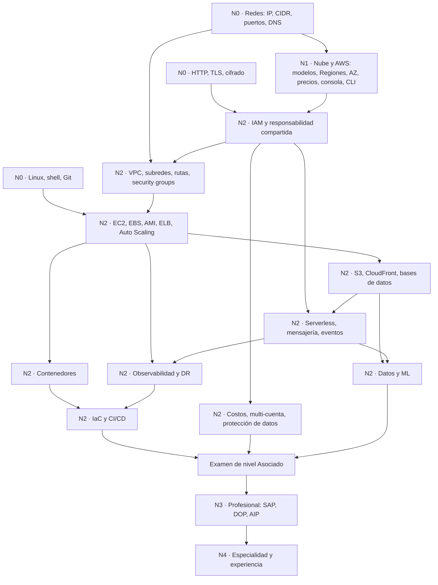

# Hoja de ruta de AWS: de cero a experto

Fecha de la investigación: 2026-10-09. Alcance: alto nivel. Cada capítulo del juego («Sigue el paquete») tendrá después su propia investigación de conceptos.

Fecha de consulta de todas las fuentes: 2026-10-09. Las fechas posteriores (retiros, versiones nuevas) son anuncios de AWS. Las cifras (pesos, códigos, fechas) salen de páginas oficiales de AWS que se leyeron ese día. Lo que no se pudo verificar se dice en el sitio donde aparece y se resume en la sección 5.

## 1. Cómo se armó

- **Columna vertebral:** los niveles de certificación de AWS (Fundamentos, Asociado, Profesional, Especialidad). Los dominios de cada guía de examen son los temas de cada nivel.
- **Criterio de calidad:** el AWS Well-Architected Framework (seis pilares) y el AWS Cloud Adoption Framework (CAF) para el nivel experto.
- **Huecos:** se compararon con roadmap.sh/aws y con tres guías de comunidad de 2026, solo para detectar temas que las guías de AWS no nombran (por ejemplo, Linux y redes como base previa).
- **Qué es una cita y qué es síntesis:** los códigos de examen, los pesos y las fechas son datos de AWS. La línea «qué cubre» de cada tema es una síntesis del copiloto sobre los task statements; no es una cita.
- **Experto:** AWS no tiene una credencial llamada «experto». El techo oficial es Profesional más Especialidad. La experiencia real se mide en años de operación; las guías piden entre 2 y 5 años según el examen.

## 2. Niveles

### 2.0 Panorama de exámenes vigentes (2026-10-09)

Los pesos suman 100 % en cada examen. «D1 30 %» significa «dominio 1, 30 % del contenido puntuado».

| Nivel AWS | Examen (código) | Dominios y pesos | Estado al 2026-10-09 |
|-----------|-----------------|------------------|----------------------|
| Fundamentos | Cloud Practitioner (CLF-C02) | D1 Cloud Concepts 24 % · D2 Security and Compliance 30 % · D3 Cloud Technology and Services 34 % · D4 Billing, Pricing, and Support 12 % | Vigente. Sin aviso de versión nueva en la página oficial. |
| Fundamentos | AI Practitioner (AIF-C01) | D1 Fundamentals of AI and ML 20 % · D2 Fundamentals of GenAI 24 % · D3 Applications of Foundation Models 28 % · D4 Responsible AI 14 % · D5 Security, Compliance, and Governance for AI 14 % | Vigente. |
| Asociado | Solutions Architect – Associate (SAA-C03) | D1 Secure 30 % · D2 Resilient 26 % · D3 High-Performing 24 % · D4 Cost-Optimized 20 % | Vigente. Un agregador citaba «SAA-C04»; no hay aviso en la página oficial, queda sin confirmar. |
| Asociado | Developer – Associate (DVA-C02) | D1 Development with AWS Services 32 % · D2 Security 26 % · D3 Deployment 24 % · D4 Troubleshooting and Optimization 18 % | En cambio: el registro de DVA-C03 abre el 2026-10-27 y el último día de DVA-C02 es el 2026-11-30. Revisar después del 2026-10-27. |
| Asociado | CloudOps Engineer – Associate (SOA-C03) | D1 Monitoring, Logging, Analysis, Remediation, Performance 22 % · D2 Reliability and Business Continuity 22 % · D3 Deployment, Provisioning, Automation 22 % · D4 Security and Compliance 16 % · D5 Networking and Content Delivery 18 % | Vigente. Antes se llamaba SysOps Administrator; la página no da fecha del cambio de nombre. |
| Asociado | Data Engineer – Associate (DEA-C01) | D1 Data Ingestion and Transformation 34 % · D2 Data Store Management 26 % · D3 Data Operations and Support 22 % · D4 Data Security and Governance 18 % | Vigente. Se lanzó el 2024-03-12. |
| Asociado | Machine Learning Engineer – Associate (MLA-C01) | D1 Data Preparation 28 % · D2 ML Model Development 26 % · D3 Deployment and Orchestration 22 % · D4 Monitoring, Maintenance, and Security 24 % (guía v1.0, PDF oficial) | En cambio: el último día de MLA-C01 en inglés fue el 2026-09-28. MLA-C02 está en beta. La página se contradice en las fechas y muestra el código ME1-C02 para la beta (sin confirmar). Fecha de disponibilidad general: por definir. No se tienen pesos de C02. |
| Profesional | Solutions Architect – Professional (SAP-C02) | D1 Organizational Complexity 26 % · D2 New Solutions 29 % · D3 Continuous Improvement 25 % · D4 Migration and Modernization 20 % | En cambio: el registro de SAP-C03 abre el 2026-10-27 y el último día de SAP-C02 es el 2026-11-16. Revisar después del 2026-10-27. |
| Profesional | DevOps Engineer – Professional (DOP-C02) | D1 SDLC Automation 22 % · D2 Configuration Management and IaC 17 % · D3 Resilient Cloud Solutions 15 % · D4 Monitoring and Logging 15 % · D5 Incident and Event Response 14 % · D6 Security and Compliance 17 % | Vigente. Sin aviso de versión nueva. |
| Profesional | Generative AI Developer – Professional (AIP-C01) | D1 FM Integration, Data Management, Compliance 31 % · D2 Implementation and Integration 26 % · D3 AI Safety, Security, Governance 20 % · D4 Operational Efficiency and Optimization 12 % · D5 Testing, Validation, Troubleshooting 11 % | Vigente. |
| Especialidad | Security – Specialty (SCS-C03) | D1 Detection 16 % · D2 Incident Response 14 % · D3 Infrastructure Security 18 % · D4 IAM 20 % · D5 Data Protection 18 % · D6 Security Foundations and Governance 14 % | Vigente. Guía v1.0 del 2026-03-26. Las versiones en chino simplificado, español (Latinoamérica) y portugués (Brasil) se retiran después del 2026-12-31; la versión en inglés sigue. |
| Especialidad | Advanced Networking – Specialty (ANS-C01) | D1 Network Design 30 % · D2 Implementation 26 % · D3 Management and Operation 20 % · D4 Security, Compliance, Governance 24 % | En retiro. Último día para presentarlo: 2026-12-31 (dos páginas oficiales). Un resumen de búsqueda decía 2026-08-25; se descarta. AWS no ofrece reemplazo y remite a cursos de Skill Builder. |

**Retirados y renombrados**

| Examen | Qué pasó | Fuente |
|--------|----------|--------|
| Machine Learning – Specialty | Último día: 2026-03-31. AWS remite a Machine Learning Engineer – Associate. | Página oficial del examen |
| Database – Specialty, Data Analytics – Specialty, SAP on AWS – Specialty | Retirados en abril de 2024. Data Engineer – Associate se lanzó el 2024-03-12. | Blog oficial de AWS, 2024-01-30 |
| SysOps Administrator – Associate | Ahora es CloudOps Engineer – Associate (SOA-C03). | Página oficial del examen |
| AI Business Strategist (AIB-C01) | Pista de negocio, no técnica. Solo se vio en resultados de búsqueda: beta con entrega desde 2026-09-29, 4 dominios (24/28/24/24 %). No se leyó la página; sin verificar. Fuera de esta hoja de ruta. | Solo búsqueda |

Guías de comunidad de 2026 que todavía recomiendan «ML Specialty» como paso siguiente están desactualizadas.

### Nivel 0 · Bases previas

**Meta:** entender lo que la nube automatiza: máquinas, redes y protocolos. **Requisitos:** ninguno. **Estado del estudiante:** sabe programar (Node, React Native); no tiene redes.

Ninguna guía de AWS enseña estas bases, pero tres guías de examen las dan por sabidas (SOA-C03, DEA-C01, DVA-C02) y las guías de comunidad las ponen primero.

| ID | Tema | Qué cubre | Respaldo |
|----|------|-----------|----------|
| N0.1 | Computación y sistema operativo | CPU, memoria, disco, procesos y servicios; qué es un servidor. | SOA-C03 («familiaridad con un sistema operativo mayor») |
| N0.2 | Línea de comandos Linux | Navegar el sistema de archivos, permisos, leer logs desde la terminal. | SOA-C03; CloudThat 2026-07-14 |
| N0.3 | Redes básicas | Dirección IP, CIDR (rango de direcciones), puertos, TCP, DNS, enrutamiento, NAT, firewall. | SOA-C03 (DNS, TCP, IP, firewalls); CloudThat |
| N0.4 | HTTP, TLS y APIs REST | Petición y respuesta, códigos de estado, qué hace TLS (cifrar el tráfico), JSON. | Síntesis; ninguna guía lo lista como tema |
| N0.5 | Cifrado y certificados (concepto) | Cifrado simétrico y asimétrico, hash, firma, qué es un certificado. | SCS-C03 (cifrado en reposo y en tránsito), SAA-C03 D1 |
| N0.6 | Git | Commits, ramas, fusiones, remoto. | DEA-C01, SOA-C03, CloudThat |
| N0.7 | Scripting y formatos | Bash o Python, JSON y YAML, variables de entorno. | SOA-C03 («un lenguaje de scripting»); CloudThat |
| N0.8 | Virtualización y contenedores (concepto) | Máquina virtual frente a contenedor, imagen, aislamiento. | SOA-C03 («contenedores y orquestación básicos») |
| N0.9 | Bases de datos (concepto) | SQL frente a NoSQL, clave primaria, índices, consistencia. | DEA-C01 (consultas SQL, almacenes de datos) |

### Nivel 1 · Fundamentos de la nube y AWS

**Meta:** hablar el idioma de AWS y saber qué problema resuelve cada familia de servicios. **Requisitos:** N0.1, N0.3 (lo mínimo). **Exámenes:** CLF-C02 (hasta 6 meses de exposición, según la guía) y AIF-C01.

| ID | Tema | Qué cubre | Respaldo |
|----|------|-----------|----------|
| N1.1 | Valor de la nube | IaaS, PaaS, SaaS, nube pública, privada, híbrida; pagar por uso; elasticidad. | CLF-C02 D1 (24 %) |
| N1.2 | Responsabilidad compartida | Qué protege AWS (la nube) y qué protege el cliente (en la nube). | CLF-C02 D2 (30 %) |
| N1.3 | Seguridad básica de la cuenta | Usuario raíz, MFA (segundo factor), IAM a vista de pájaro, cifrado, cumplimiento. | CLF-C02 D2 (30 %) |
| N1.4 | Infraestructura global | Regiones, zonas de disponibilidad (AZ), ubicaciones de borde. | CLF-C02 D3 (34 %) |
| N1.5 | Servicios núcleo | Cómputo, almacenamiento, bases de datos y redes: qué hace cada familia y cuándo. | CLF-C02 D3 (34 %) |
| N1.6 | Precios, facturación y soporte | Modelos de precio, nivel gratuito, presupuestos, planes de soporte. | CLF-C02 D4 (12 %) |
| N1.7 | Acceso a AWS | Consola, AWS CLI, SDK, claves de acceso temporales frente a permanentes. | CLF-C02 D3; síntesis |
| N1.8 | Well-Architected y CAF (vista general) | Los seis pilares: excelencia operativa, seguridad, fiabilidad, eficiencia de rendimiento, optimización de costos, sostenibilidad. | CLF-C02 (la guía lo lista); Well-Architected |
| N1.9 | Fundamentos de IA, ML e IA generativa | Qué es un modelo, entrenamiento frente a inferencia, modelos fundacionales (FM). | AIF-C01 D1 (20 %), D2 (24 %) |
| N1.10 | Aplicaciones con modelos fundacionales | Prompts, RAG (buscar contexto antes de generar), elección de modelo. | AIF-C01 D3 (28 %) |
| N1.11 | IA responsable, seguridad y gobernanza de IA | Sesgo, transparencia, privacidad, cumplimiento. | AIF-C01 D4 (14 %), D5 (14 %) |

### Nivel 2 · Asociado

**Meta:** diseñar, desplegar y operar cargas reales en AWS. **Requisitos:** Nivel 1 y N0.3 sólido. **Exámenes:** SAA-C03 (1 año de experiencia), DVA-C02/C03 (1 año o más), SOA-C03 (1 año en AWS y 1 año en operaciones), DEA-C01 (2–3 años de ingeniería de datos y 1–2 años en AWS), MLA-C01/C02.

Los temas siguen las áreas transversales. Los códigos de examen son los de cada guía; las guías de DVA y MLA cambian después del 2026-10-27.

| ID | Tema | Qué cubre | Respaldo |
|----|------|-----------|----------|
| N2.1 | Diseño con Well-Architected | Elegir arquitecturas seguras, resilientes, rápidas y económicas; revisar una solución existente. | SAA-C03 (los 4 dominios) |
| N2.2 | Identidad y acceso | IAM (usuarios, roles, políticas), STS (credenciales temporales), acceso entre cuentas, IAM Identity Center, federación. | SAA-C03 D1 T1.1; DVA-C02 D2 (26 %) |
| N2.3 | Protección de datos y secretos | AWS KMS (claves de cifrado), AWS Certificate Manager (ACM), AWS Secrets Manager, rotación. | SAA-C03 D1 T1.3 |
| N2.4 | Seguridad de aplicaciones | AWS WAF y AWS Shield (ataques web y DDoS), Amazon GuardDuty, Amazon Macie, Amazon Cognito. | SAA-C03 D1 T1.2; SOA-C03 D4 (16 %) |
| N2.5 | Redes en AWS | Amazon VPC, subredes, tablas de rutas, gateways, security groups y NACL, VPC endpoints, peering, AWS Transit Gateway. | SAA-C03 D3 T3.4; SOA-C03 D5 (18 %) |
| N2.6 | Conectividad híbrida | AWS VPN, AWS Direct Connect, AWS PrivateLink: unir la nube con una oficina o un centro de datos. | SAA-C03 D1 T1.2, D3 T3.4 |
| N2.7 | Borde y DNS | Amazon CloudFront (CDN), Amazon Route 53 (DNS y políticas de enrutamiento), AWS Global Accelerator. | SAA-C03 D3 T3.4; SOA-C03 D5 |
| N2.8 | Cómputo y escalado | Amazon EC2, AMI, Amazon EBS, balanceadores (ELB), Auto Scaling, opciones de compra. | SAA-C03 D3 T3.2; SOA-C03 |
| N2.9 | Contenedores | Registro de imágenes (Amazon ECR), Amazon ECS, AWS Fargate, Amazon EKS: cuándo cada uno. | SAA-C03 D2 T2.1, D3 T3.2 |
| N2.10 | Serverless y APIs | AWS Lambda, Amazon API Gateway, eventos y límites. | SAA-C03 D2 T2.1; DVA-C02 D1 (32 %) |
| N2.11 | Mensajería, eventos y flujos | Amazon SQS (colas), Amazon SNS (publicar y suscribir), Amazon EventBridge, AWS Step Functions. | SAA-C03 D2 T2.1; DVA-C02 D1 |
| N2.12 | Almacenamiento | Objeto (Amazon S3), bloque (EBS), archivos (Amazon EFS, Amazon FSx), clases y ciclo de vida. | SAA-C03 D3 T3.1 |
| N2.13 | Bases de datos | Amazon RDS, Amazon Aurora, Amazon DynamoDB, Amazon ElastiCache; réplicas, caché, patrones de acceso. | SAA-C03 D3 T3.3 |
| N2.14 | Resiliencia y recuperación ante desastres (DR) | Alta disponibilidad, Multi-AZ, copias de seguridad, RPO (cuántos datos se pueden perder) y RTO (cuánto se tarda en volver), estrategias de DR. | SAA-C03 D2 (26 %); SOA-C03 D2 (22 %) |
| N2.15 | Observabilidad y operaciones | Amazon CloudWatch (métricas, logs, alarmas), AWS CloudTrail, AWS X-Ray, AWS Systems Manager, remediación. | SOA-C03 D1 (22 %); DVA-C02 D4 (18 %) |
| N2.16 | Infraestructura como código (IaC) | Describir la infraestructura en archivos versionables: AWS CloudFormation, AWS CDK; Terraform como alternativa de comunidad. | SOA-C03 D3 (22 %); DVA-C02 D3 (24 %) |
| N2.17 | CI/CD y estrategias de despliegue | Integración y entrega continuas, AWS CodeBuild, CodePipeline, CodeDeploy, blue/green, canary, rollback. | DVA-C02 D3 (24 %); SAP-C02 T2.1 |
| N2.18 | Costos y FinOps | FinOps = gestionar el gasto de la nube: ver, asignar y optimizar. AWS Cost Explorer, AWS Budgets, Savings Plans, rightsizing. | SAA-C03 D4 (20 %) |
| N2.19 | Multi-cuenta y gobierno básico | AWS Organizations, políticas de control de servicio (SCP), AWS Control Tower, AWS Config. | SAA-C03 D1 T1.1 |
| N2.20 | Transferencia y migración de datos | AWS DataSync, AWS Transfer Family, AWS Storage Gateway, AWS Snow Family. | SAA-C03 D3 T3.5 |
| N2.21 | Datos y analítica | Lagos de datos en S3, AWS Glue, Amazon Athena, Amazon Kinesis, AWS Lake Formation, Amazon Redshift, Amazon EMR, Amazon Quick. | DEA-C01 (34/26/22/18 %); SAA-C03 T3.5 |
| N2.22 | ML en producción (MLOps) | Preparar datos, entrenar, desplegar, orquestar y monitorear modelos con Amazon SageMaker AI. | MLA-C01 v1.0 (28/26/22/24 %); MLA-C02 en beta |
| N2.23 | Desarrollo con SDK, API e IA asistida | SDK y CLI, reintentos e idempotencia, pruebas; herramientas de IA para generar código y revisar. | DVA-C02 D1 y «emerging topics» |

### Nivel 3 · Profesional

**Meta:** resolver problemas de organización completa: varias cuentas, varias Regiones, migraciones y operación continua. **Requisitos:** Nivel 2 y 2 o más años de experiencia (SAP-C02, DOP-C02, AIP-C01 la piden en la guía). **Exámenes:** SAP-C02/C03, DOP-C02, AIP-C01.

| ID | Tema | Qué cubre | Respaldo |
|----|------|-----------|----------|
| N3.1 | Conectividad de red a escala | Muchas VPC, híbrido, DNS híbrido, enrutamiento transitivo, solución de problemas de flujos. | SAP-C02 D1 T1.1 |
| N3.2 | Controles de seguridad entre cuentas | Proveedores de identidad externos, cifrado a escala, notificación y auditoría centralizadas. | SAP-C02 D1 T1.2 |
| N3.3 | Entorno multi-cuenta | Estructura de cuentas, AWS Organizations, AWS Control Tower, logging central, compartir recursos. | SAP-C02 D1 T1.4 |
| N3.4 | Resiliencia y DR a escala | RTO y RPO por servicio, AWS Elastic Disaster Recovery, multi-Región, pruebas de DR. | SAP-C02 D1 T1.3, D2 T2.2, T2.4; DOP-C02 D3 (15 %) |
| N3.5 | Costos y visibilidad a escala | Etiquetado, informes de costo y uso, modelado de transferencia de datos. | SAP-C02 D1 T1.5, D2 T2.6, D3 T3.5 |
| N3.6 | Diseño de soluciones nuevas | Despliegue, continuidad, seguridad, fiabilidad y rendimiento de una solución desde cero. | SAP-C02 D2 (29 %) |
| N3.7 | Mejora continua de lo existente | Mejorar una carga que ya corre: operación, seguridad, rendimiento, fiabilidad y costo. | SAP-C02 D3 (25 %) |
| N3.8 | Migración y modernización | Las 7 R (estrategias de migración), AWS Migration Hub, Application Migration Service, AWS DMS; desacoplar y pasar a serverless. | SAP-C02 D4 (20 %) |
| N3.9 | Automatización del ciclo de vida del software | Pipelines completos, pruebas automáticas, estrategias de despliegue y rollback. | DOP-C02 D1 (22 %) |
| N3.10 | Gestión de configuración e IaC avanzada | Plantillas reutilizables, parches, flotas de instancias, deriva de configuración. | DOP-C02 D2 (17 %) |
| N3.11 | Monitoreo y logging a escala | Métricas y logs entre cuentas, alarmas por SLO (objetivo de nivel de servicio), trazas. | DOP-C02 D4 (15 %) |
| N3.12 | Respuesta a incidentes y eventos | Detectar, clasificar y remediar de forma automática; runbooks. | DOP-C02 D5 (14 %) |
| N3.13 | Seguridad y cumplimiento automatizados | Políticas como código, auditoría continua, gestión de secretos y parches. | DOP-C02 D6 (17 %) |
| N3.14 | IA generativa en producción | Integrar FM, RAG con almacenes vectoriales, agentes, ingeniería de prompts. | AIP-C01 D1 (31 %), D2 (26 %) |
| N3.15 | Seguridad, optimización y pruebas de GenAI | Guardrails (Amazon Bedrock Guardrails), acceso de agentes (AgentCore Identity), costo, evaluación, depuración. | AIP-C01 D3–D5 (43 %); SAP-C02 «emerging topics» |

### Nivel 4 · Especialista y experto

**Meta:** profundidad en un campo y criterio para decidir en una organización. **Requisitos:** Nivel 3 o experiencia equivalente. **Exámenes:** SCS-C03 y ANS-C01 (en retiro). No hay especialidades vigentes de datos ni de ML: ML, Database, Data Analytics y SAP están retirados.

| ID | Tema | Qué cubre | Respaldo |
|----|------|-----------|----------|
| N4.1 | Seguridad: detección | Fuentes de señal, correlación, alertas. | SCS-C03 D1 (16 %) |
| N4.2 | Seguridad: respuesta a incidentes | Contención, forense, causa raíz, recuperación. | SCS-C03 D2 (14 %) |
| N4.3 | Seguridad de infraestructura | Reglas de firewall en capas 3 a 7, aislamiento de red, cadena de suministro de software. | SCS-C03 D3 (18 %) |
| N4.4 | IAM a escala | Identidad a escala, permisos mínimos, auditorías de acceso. | SCS-C03 D4 (20 %) |
| N4.5 | Protección de datos avanzada | Clasificación, cifrado en reposo y en tránsito, copias y retención. | SCS-C03 D5 (18 %) |
| N4.6 | Fundamentos y gobierno de seguridad | Gobierno multi-cuenta, cumplimiento, respuesta a auditorías. | SCS-C03 D6 (14 %) |
| N4.7 | Redes avanzadas e híbridas | Diseño, implementación, operación y seguridad de redes a escala. Examen en retiro; el contenido sigue vigente. | ANS-C01 (30/26/20/24 %), hasta el 2026-12-31 |
| N4.8 | Datos y ML a profundidad | Sin examen de especialidad vigente: se cubre con DEA-C01, MLA y AIP-C01 más práctica. | Ver retirados |
| N4.9 | Revisión con lentes de Well-Architected | Aplicar lentes (Serverless Applications, SaaS, Generative AI, Machine Learning, Data Analytics, DevOps, Migration, Container Build, IoT, entre otras). | Lens Catalog de AWS |
| N4.10 | Adopción en la organización (CAF) | Seis perspectivas (Business, People, Governance, Platform, Security, Operations) y cuatro fases (Envision, Align, Launch, Scale). | Página del CAF; el whitepaper es de 2021-11-22 |
| N4.11 | Experiencia de operación | Operar cargas reales: guardias, incidentes, costos, post-mortems. No se mide con examen. | Años pedidos por las guías: 2+ (SAP, DOP), 3–5 (SCS), 5+ en redes (ANS) |

### Áreas transversales y dónde aparecen

| Área | N0 | N1 | N2 | N3 | N4 |
|------|----|----|----|----|----|
| Redes | N0.3 | N1.4 | N2.5, N2.6, N2.7 | N3.1 | N4.7 |
| Seguridad e IAM | N0.5 | N1.2, N1.3 | N2.2, N2.3, N2.4 | N3.2, N3.13 | N4.1–N4.6 |
| Observabilidad | — | — | N2.15 | N3.11, N3.12 | N4.2 |
| Costos y FinOps | — | N1.6 | N2.18 | N3.5 | N4.10 |
| IaC | N0.7 | — | N2.16 | N3.10 | — |
| CI/CD | N0.6 | — | N2.17 | N3.9 | — |
| Datos | N0.9 | N1.5 | N2.12, N2.13, N2.21 | N3.8 | N4.8 |
| IA y ML | — | N1.9–N1.11 | N2.22 | N3.14, N3.15 | N4.8 |
| Migración | — | — | N2.20 | N3.8 | N4.10 |
| Multi-cuenta y gobierno | — | N1.8 | N2.19 | N3.3 | N4.6 |
| Resiliencia y DR | — | N1.4 | N2.14 | N3.4 | N4.9 |
| Contenedores | N0.8 | — | N2.9 | N3.8 | N4.9 |
| Serverless | — | — | N2.10, N2.11 | N3.8 | N4.9 |
| Borde | — | N1.4 | N2.7 | N3.7 | N4.7 |

### Recursos oficiales de estudio (resumen)

- **Skill Builder:** cursos de preparación de examen y bancos de 20 preguntas gratis; exámenes de práctica oficiales con suscripción (desde 29 USD al mes, según la página de AWS). Los planes de aprendizaje de Skill Builder no se pudieron leer (requieren sesión); solo se vio un blog de socios de 2023.
- **Ramp-Up Guides:** por rol (Decision Maker, Developer, DevOps, Solutions Architect, Cloud Operator) y por solución (por ejemplo Cloud Essentials, Cloud Financial Management, Compute, Containers, AWS Modernization Pathways). La lista completa tiene 24 soluciones; la página solo mostró 8.
- **Rutas «Learn about»:** por rol (Solutions Architect, Cloud Practitioner, Developer, DevOps Engineer, ML/AI, Operations) y por solución (IA, Data Analytics, Security, Databases, Advanced Networking, Serverless, Storage).
- **AWS Cloud Institute:** una búsqueda lo daba por cerrado el 2026-06-30; la URL oficial redirige a Skill Builder y no se leyó el destino. Sin verificar.

## 3. Mapa contra el curso

Se compara con los **títulos** de `syllabus.md` (ver [`../../syllabus.md`](../../syllabus.md)). Un título no prueba la profundidad. «No aparece en los títulos» no significa que el curso no lo mencione dentro de una clase.

| Tema | Módulos del curso | Cobertura según los títulos |
|------|-------------------|------------------------------|
| N0.1–N0.2 Computación y Linux | Clase magistral «Introducción a Bash» (opcional); M8 (namespaces, cgroups) | Parcial: no hay lección de Linux ni de permisos |
| N0.3 Redes básicas | M9 (IP, puertos, enrutado, DNS); M4 (Security Groups) | Cubre, pero M9 llega después de M4, M5 y M7 |
| N0.4 HTTP y TLS | — | No aparece en los títulos |
| N0.5 Cifrado y certificados | — | No aparece en los títulos |
| N0.6 Git | M15 (opcional); M14 (flujos de trabajo con Git) | Cubre |
| N0.7 Scripting y formatos | Clase de Bash (opcional); M13 (variables, módulos) | Parcial |
| N0.8 Contenedores (concepto) | M8 | Cubre |
| N0.9 Bases de datos (concepto) | M3; M7 («Introducción a las bases de datos relacionales»); M12 | Cubre |
| N1.1–N1.2 Valor de la nube, responsabilidad compartida | M2 | Cubre |
| N1.3 Seguridad básica de la cuenta | M3 (Consola); M17 (IAM) | Parcial: raíz y MFA no aparecen en los títulos |
| N1.4–N1.5 Infraestructura global, servicios núcleo | M3 | Cubre |
| N1.6 Precios, facturación, soporte | M3 (modelo de precios); M4, M6; M17 (FinOps) | Cubre; planes de soporte no aparecen |
| N1.7 Acceso a AWS | M3 (Consola, AWS CLI, lab 01) | Cubre |
| N1.8 Well-Architected y CAF | M10 («AWS Well-Architected Framework») | Cubre Well-Architected; CAF no aparece |
| N1.9–N1.11 IA generativa | Clase magistral «IA Generativa con AWS Bedrock» | Sin lecciones publicadas |
| N2.1 Diseño con Well-Architected | M10 | Parcial |
| N2.2 Identidad y acceso | M17 (IAM, identidades, condiciones); M6 (políticas) | Cubre; STS e Identity Center no aparecen |
| N2.3 Datos y secretos | — | No aparece en los títulos |
| N2.4 Seguridad de aplicaciones | M11 («Authorizers, Usage Plans y API Keys») | Parcial: WAF, Shield, GuardDuty, Macie y Cognito no aparecen |
| N2.5 Redes en AWS | M9 (VPC, subredes, rutas, IGW/NAT/EIP, NACL, endpoints, peering, Transit Gateway, NLB); M4 | Cubre |
| N2.6 Conectividad híbrida | — | VPN y Direct Connect no aparecen en los títulos |
| N2.7 Borde y DNS | M6 (CloudFront, funciones Edge); M9 (DNS) | Parcial: Route 53 y Global Accelerator no aparecen |
| N2.8 Cómputo y escalado | M4 (EC2, AMI, EBS, pricing); M5 (ELB, Auto Scaling) | Cubre |
| N2.9 Contenedores | M8 (Docker, ECR, ECS, Fargate); M18 (Kubernetes); M19 (EKS) | Cubre ECR, ECS y Fargate. EKS: sin lecciones publicadas |
| N2.10 Serverless y APIs | M11 (Lambda, API Gateway) | Cubre |
| N2.11 Mensajería y flujos | M11 (SQS, SNS, EventBridge, Step Functions) | Cubre |
| N2.12 Almacenamiento | M3; M4 (EBS); M6 (S3); M7 («Panorama de servicios de almacenamiento») | Cubre S3 y EBS; EFS y FSx solo en el panorama |
| N2.13 Bases de datos | M7 (RDS); M12 (DynamoDB) | Cubre; Aurora y ElastiCache no aparecen |
| N2.14 Resiliencia y DR | M5; M7 (Multi-AZ, backup, réplicas); M10 (tolerante a fallos) | Parcial: estrategias de DR y RPO/RTO no aparecen |
| N2.15 Observabilidad | M16 (CloudWatch, X-Ray, OpenTelemetry); M17 (CloudTrail, Config) | Cubre; Systems Manager no aparece |
| N2.16 IaC | M13 (Terraform) | Parcial: CloudFormation y CDK no aparecen |
| N2.17 CI/CD | M14 (CodeBuild, CodePipeline, CodeDeploy, blue/green, canary, GitHub Actions) | Cubre |
| N2.18 Costos y FinOps | M17 | Cubre |
| N2.19 Multi-cuenta y gobierno | M17 («Gestión de Múltiples Cuentas», SCPs, CloudTrail, Config) | Cubre; Control Tower no aparece |
| N2.20 Migración de datos | M10 («Estrategias de Migración al Cloud») | Parcial: las herramientas no aparecen |
| N2.21 Datos y analítica | — | No aparece en los títulos |
| N2.22 ML en producción | — | No aparece en los títulos |
| N2.23 SDK, API e IA asistida | M6 («Integración de S3 en aplicaciones con TypeScript»); clase de GitHub Actions agéntico | Parcial |
| N3 Profesional | M10, M14 (rollbacks, GitOps), M16 (SLI), M17; M20 (proyecto final) | Parcial: la base de DOP-C02 D1 y D4 está; el resto no aparece |
| N4 Especialista | — | Fuera del alcance del curso |

**Temas que no aparecen en los títulos del curso**

Verificado con una búsqueda de texto en `syllabus.md`:

- Linux (solo hay una clase opcional de Bash) y HTTP/TLS.
- AWS CloudFormation y AWS CDK (el curso enseña Terraform).
- AWS KMS, AWS Certificate Manager, AWS Secrets Manager (el «Secrets» del temario es de Kubernetes).
- AWS WAF, AWS Shield, Amazon GuardDuty, AWS Security Hub, Amazon Inspector, Amazon Macie, Amazon Cognito.
- Amazon Route 53 y sus políticas de enrutamiento (el temario enseña DNS en general).
- AWS VPN y AWS Direct Connect.
- Estrategias de recuperación ante desastres, RPO y RTO.
- Amazon ElastiCache y Amazon Aurora.
- Analítica de datos: AWS Glue, Amazon Athena, Amazon Kinesis, Amazon Redshift.
- IA y ML: Amazon SageMaker AI (Bedrock tiene una clase magistral sin lecciones).
- AWS Systems Manager, AWS Cost Explorer y Trusted Advisor, herramientas de migración (AWS DMS, AWS DataSync).
- Amazon SES, que roadmap.sh incluye en su lista.
- Preparación explícita para los exámenes de AWS. El «certificado» del módulo 20 es el del curso.

**Módulos incompletos en el temario:** M19 (EKS) y la clase de Bedrock no tienen lecciones publicadas.

## 4. Orden recomendado y dependencias

**Alerta para este estudiante:** no tiene redes, y los módulos 4, 5 y 7 ya las necesitan (security groups, balanceadores, RDS privado). El curso enseña redes en el módulo 9. Conviene subir N0.3 antes de seguir con M4 y M5. Los temas de seguridad (N0.5) y HTTP (N0.4) tampoco están en el curso.

**Orden sugerido (criterio del copiloto; AWS no exige un orden entre exámenes)**

1. N0.3 Redes básicas y N0.2 Linux: antes de los labs de security groups y ping.
2. N1 completo: cuenta segura, consola, CLI, regiones y precios.
3. IAM (N2.2): sin esto, nada más se configura bien.
4. VPC (N2.5) y cómputo (N2.8): ahí vive el paquete que viaja.
5. Almacenamiento y bases de datos (N2.12, N2.13), con CloudFront (N2.7).
6. Serverless, mensajería y contenedores (N2.9–N2.11).
7. Observabilidad, DR y resiliencia (N2.14, N2.15): se aprenden mejor después de haber roto algo.
8. IaC y CI/CD (N2.16, N2.17), con CloudFormation además de Terraform.
9. Costos, multi-cuenta y protección de datos (N2.18, N2.19, N2.3, N2.4).
10. Datos y ML (N2.21, N2.22), según el rol que se busque.
11. Un examen de nivel Asociado. Orientación: SAA-C03 es el más general. Para un perfil de desarrollo, DVA-C03 cuando abra (2026-10-27).
12. Profesional (N3) y Especialidad (N4) cuando haya años de práctica; no antes.

**Dependencias clave**

- VPC depende de N0.3; nadie diseña subredes sin entender CIDR y rutas.
- Security groups y NACL dependen de VPC y de puertos (N0.3).
- ELB y Auto Scaling dependen de VPC, EC2 y health checks.
- Una RDS privada depende de VPC y security groups.
- IaC depende de saber a mano lo que se va a describir.
- Profesional depende de multi-cuenta y de redes híbridas, que el curso no cubre.

## 5. Fuentes

Todas consultadas el **2026-10-09**. Solo se listan las páginas que se leyeron, salvo donde se indica «solo búsqueda».

**AWS: certificaciones**

- https://aws.amazon.com/certification/ (lista de niveles; fechas de retiro y actualización)
- https://aws.amazon.com/certification/certified-cloud-practitioner/
- https://aws.amazon.com/certification/certified-ai-practitioner/
- https://aws.amazon.com/certification/certified-solutions-architect-associate/
- https://aws.amazon.com/certification/certified-developer-associate/
- https://aws.amazon.com/certification/certified-cloudops-engineer-associate/
- https://aws.amazon.com/certification/certified-data-engineer-associate/
- https://aws.amazon.com/certification/certified-machine-learning-engineer-associate/
- https://aws.amazon.com/certification/certified-solutions-architect-professional/
- https://aws.amazon.com/certification/certified-devops-engineer-professional/
- https://aws.amazon.com/certification/certified-generative-ai-developer-professional/
- https://aws.amazon.com/certification/certified-security-specialty/
- https://aws.amazon.com/certification/certified-advanced-networking-specialty/
- https://aws.amazon.com/certification/certified-machine-learning-specialty/
- https://aws.amazon.com/blogs/training-and-certification/aws-certification-retirements-and-launches (2024-01-30)
- https://aws.amazon.com/certification/certification-prep/

**AWS: guías de examen**

- https://docs.aws.amazon.com/aws-certification/latest/cloud-practitioner-02/cloud-practitioner-02.html
- https://docs.aws.amazon.com/aws-certification/latest/ai-practitioner-01/ai-practitioner-01.html
- https://docs.aws.amazon.com/aws-certification/latest/solutions-architect-associate-03/solutions-architect-associate-03.html (y dominios 1 a 3)
- https://docs.aws.amazon.com/aws-certification/latest/developer-associate-02/developer-associate-02.html
- https://docs.aws.amazon.com/aws-certification/latest/sysops-administrator-associate-03/sysops-administrator-associate-03.html
- https://docs.aws.amazon.com/aws-certification/latest/data-engineer-associate-01/data-engineer-associate-01.html
- https://d1.awsstatic.com/training-and-certification/docs-machine-learning-engineer-associate/AWS-Certified-Machine-Learning-Engineer-Associate_Exam-Guide.pdf (MLA-C01 v1.0)
- https://docs.aws.amazon.com/aws-certification/latest/solutions-architect-professional-02/solutions-architect-professional-02.html (y dominios 1 a 4)
- https://docs.aws.amazon.com/aws-certification/latest/devops-engineer-professional-02/devops-engineer-professional-02.html
- https://docs.aws.amazon.com/aws-certification/latest/ai-professional-01/ai-professional-01.md
- https://docs.aws.amazon.com/aws-certification/latest/security-specialty-03/security-specialty-03.html
- https://docs.aws.amazon.com/aws-certification/latest/security-specialty-03/scs03-revisions.html
- https://docs.aws.amazon.com/aws-certification/latest/advanced-networking-specialty-01/advanced-networking-specialty-01.html

**AWS: marcos de referencia y formación**

- https://docs.aws.amazon.com/wellarchitected/latest/framework/the-pillars-of-the-framework.html (seis pilares)
- https://docs.aws.amazon.com/wellarchitected/latest/userguide/lens-catalog.html (lentes)
- https://aws.amazon.com/cloud-adoption-framework/ (seis perspectivas, cuatro fases)
- https://docs.aws.amazon.com/whitepapers/latest/overview-aws-cloud-adoption-framework/welcome.html (whitepaper del 2021-11-22)
- https://aws.amazon.com/training/ramp-up-guides/
- https://aws.amazon.com/training/learn-about/
- https://aws.amazon.com/blogs/apn/start-your-learning-journey-with-the-right-roadmap-from-aws-training-and-certification (2023-06-29)

**Comunidad (solo para detectar huecos)**

- https://roadmap.sh/aws: la página se leyó, pero el diagrama no se renderizó. Los nombres de unos 100 temas salen de los archivos del repositorio (https://github.com/kamranahmedse/developer-roadmap, carpeta `roadmaps/aws/content`, listada con la API de GitHub). No se leyó el orden del diagrama.
- https://digitalcloud.training/is-aws-still-worth-learning-in-2026/
- https://www.cloudthat.com/resources/blog/aws-devops-training-for-cloud-engineers-what-to-learn-before-ci-cd-projects (2026-07-14)
- https://stormwindstudios.com/blog/the-aws-certification-path-in-2026-every-level-cost-and-the-smartest-route (2026-07-20; lista «ML Specialty», desactualizada)

**Solo búsqueda (no se abrió la página)**

- AWS Certified AI Business Strategist: https://aws.amazon.com/certification/certified-ai-business-strategist/
- Cierre de AWS Cloud Institute (2026-06-30): https://aws.amazon.com/training/aws-cloud-institute/ redirige a https://skillbuilder.aws/, que no se leyó.
- Fecha 2026-08-25 de retiro de ANS-C01: descartada, contradice a AWS.

**No se pudo verificar**

- Los planes de aprendizaje de Skill Builder (requieren sesión; solo un blog de socios de 2023).
- La lista completa de Ramp-Up Guides por solución (24; la página mostró 8).
- El orden del diagrama de roadmap.sh.
- Los pesos de MLA-C02, DVA-C03 y SAP-C03 (aún no publicados en lo que se leyó).
- Número de versión del CAF (la página no lo da; solo la fecha del whitepaper, 2021-11-22).
- Si el cambio de nombre SysOps → CloudOps tiene fecha oficial.
