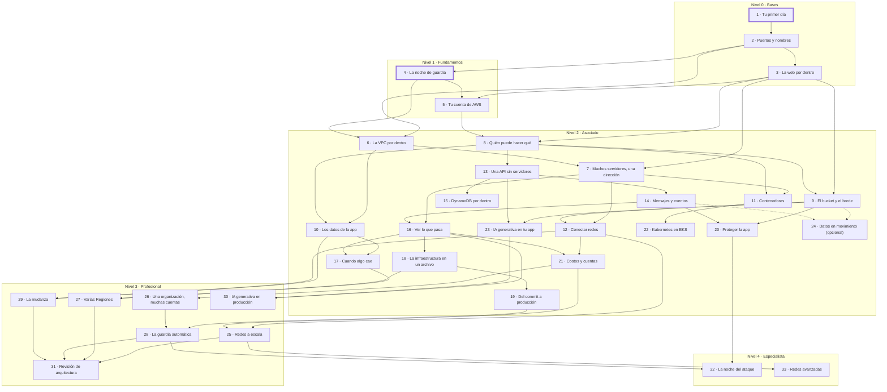

# Sigue el paquete: capítulos de cero a experto

Fecha: 2026-10-09 · Estado: aprobado por el estudiante el 2026-10-10, tal cual («Cambia todo el temario del juego para que muestre los 33 caps»). El juego lo sigue desde el [plan de los 33 capítulos](../plans/2026-10-10-follow-the-packet-33-chapters.md).

Base: [hoja de ruta de AWS](2026-10-09-aws-roadmap-zero-to-expert.md) (niveles, 69 temas, dependencias), [`syllabus.md`](../course/syllabus.md) (20 módulos), [spec de incidentes en vivo](../specs/2026-10-08-follow-the-packet-live-incidents-design.md) y [spec del capítulo 1](../specs/2026-10-09-follow-the-packet-chapter-1-design.md).

Este documento solo corta capítulos. No diseña incidentes ni lista conceptos: eso lo hará después una investigación por capítulo, que parte de las preguntas de cada ficha.

## 1. Criterios

- **Por niveles.** Cada capítulo pertenece a un nivel de la hoja de ruta: 0 Bases, 1 Fundamentos, 2 Asociado, 3 Profesional, 4 Especialista. Un tema cambia de nivel solo si sus dependencias lo obligan (sección 4).
- **Por dependencias.** Un capítulo usa solo términos de capítulos anteriores, como pide la escalera de términos. Si dos capítulos no dependen entre sí, manda el orden del curso.
- **Algo viaja.** Cada capítulo tiene un flujo que recorre el mapa (paquete, petición HTTP, llamada a la API, objeto, mensaje, cambio, commit, log o métrica) y una configuración que el jugador cambia. Lo que no viaja se reparte en otro capítulo o queda fuera.
- **Valor para el empleo.** Primero el problema y el «cuándo no». Lo que se pregunta en entrevistas de desarrollo y nube (red, IAM, S3, bases, serverless, contenedores, observabilidad, IaC, CI/CD) tiene capítulo propio. Las ramas de un rol concreto son opcionales o quedan fuera.
- **Tamaño.** Un capítulo es una guardia: un mapa que crece, con 4 a 8 incidentes. Es una estimación; la investigación de cada capítulo la fija.
- **Números.** El número es el orden del juego, no el módulo del curso. Los capítulos 1 y 4, que ya existen, conservan su número.
- **Exámenes.** «DVA» y «SAP» van sin versión: pasan a C03 (registro desde el 2026-10-27, según la hoja de ruta).

## 2. Mapa de capítulos

33 capítulos: 3 en el nivel 0, 2 en el 1, 19 en el 2 (uno opcional), 7 en el 3 y 2 en el 4.

| Nº | Nivel | Título | Qué viaja | Temas del roadmap | Módulos del curso | Certificación |
|----|-------|--------|-----------|-------------------|-------------------|---------------|
| 1 | 0 | Tu primer día | Un ping (ICMP) en la oficina | N0.3 Redes básicas (IP, ICMP, router, IP privada, firewall) | Adelanta M9; cita el lab 03 (M4) | Base que dan por sabida SOA-C03, DVA y DEA-C01 |
| 2 | 0 | Puertos y nombres | Paquetes TCP y UDP con puerto; una consulta DNS; la salida por NAT | N0.3 Redes básicas (puertos, TCP, UDP, CIDR, rutas, NAT, IP pública, DNS) | Adelanta M9 (IP, puertos, enrutado, DNS) | Igual que el 1 |
| 3 | 0 | La web por dentro | Una petición HTTP, su respuesta y el saludo TLS | N0.4 HTTP, TLS y APIs REST · N0.5 Cifrado y certificados · N0.1 Computación y sistema operativo | No aparece en los títulos | Ninguna lo lista; el cifrado apoya SAA-C03 y SCS-C03 |
| 4 | 1 | La noche de guardia | Paquetes entre instancias EC2 de una VPC | N1.5 Servicios núcleo · N1.4 Infraestructura global (Región, AZ) · N1.1 Valor de la nube (IaaS) · N2.8 Cómputo (EC2, parte) · N2.5 Redes en AWS (Security Groups, parte) | M3, M4 | CLF-C02 · SAA-C03 |
| 5 | 1 | Tu cuenta de AWS | Una llamada a la API de AWS | N1.3 Seguridad básica de la cuenta · N1.7 Acceso a AWS · N1.2 Responsabilidad compartida · N1.6 Precios y facturación · N1.4 (endpoint regional) · N2.23 (SDK) | M2, M3 (consola, CLI, lab 01) | CLF-C02 |
| 6 | 2 | La VPC por dentro | Paquetes entre subredes, hacia internet y desde internet | N2.5 Redes en AWS (subredes, rutas, gateways, network ACL) | M9 (primera mitad); la necesitan M4, M5 y M7 | SAA-C03 · SOA-C03 |
| 7 | 2 | Muchos servidores, una dirección | Peticiones HTTP que reparte un balanceador; instancias que nacen y mueren | N2.8 Cómputo y escalado · N2.14 Resiliencia (Multi-AZ) · N2.3 (ACM) | M4 (AMI, UserData, EBS), M5, M9 (NLB), M10 (sin estado) | SAA-C03 · SOA-C03 |
| 8 | 2 | Quién puede hacer qué | Una llamada a la API firmada por un rol | N2.2 Identidad y acceso · N2.3 Protección de datos y secretos (KMS, Secrets Manager) | M6 (políticas), M17 (IAM) | SAA-C03 · DVA |
| 9 | 2 | El bucket y el borde | Un GET de un objeto, del navegador al borde y al bucket | N2.12 Almacenamiento (S3) · N2.7 Borde y DNS (CloudFront) · N1.4 (ubicaciones de borde) | M6 | SAA-C03 · DVA |
| 10 | 2 | Los datos de la app | Una consulta SQL; la copia de datos a otra AZ | N2.13 Bases de datos (RDS, Aurora, ElastiCache) · N2.12 (EFS, FSx) · N2.14 (Multi-AZ, réplicas, backup) · N0.9 Bases de datos | M7 | SAA-C03 |
| 11 | 2 | Contenedores | Una imagen, del registro a la tarea; peticiones a las tareas | N2.9 Contenedores (ECR, ECS, Fargate) · N0.8 Virtualización y contenedores | M8 | SAA-C03 · DVA |
| 12 | 2 | Conectar redes | Paquetes entre VPC, hacia servicios de AWS y desde la oficina | N2.5 (endpoints, peering, Transit Gateway) · N2.6 Conectividad híbrida | M9 (segunda mitad) | SAA-C03 · SOA-C03 |
| 13 | 2 | Una API sin servidores | Una petición HTTP que se vuelve una invocación de Lambda | N2.10 Serverless y APIs · N1.1 (modelos de servicio, parte) | M10 (API Gateway), M11 | DVA · SAA-C03 |
| 14 | 2 | Mensajes y eventos | Un mensaje o evento que nadie espera en el momento | N2.11 Mensajería, eventos y flujos · N2.23 (reintentos, idempotencia) | M11 | DVA · SAA-C03 |
| 15 | 2 | DynamoDB por dentro | Una lectura o escritura con su clave, hacia una partición | N2.13 (DynamoDB) | M12 | DVA · SAA-C03 |
| 16 | 2 | Ver lo que pasa | Logs, métricas y trazas; una alarma hacia quien está de guardia | N2.15 Observabilidad y operaciones | M16, M17 (CloudTrail), M10 (lab de errores) | SOA-C03 · DVA |
| 17 | 2 | Cuando algo cae | Una consulta DNS que elige destino; copias de datos a otra AZ o Región | N2.14 Resiliencia y DR · N2.7 (Route 53, Global Accelerator) | M5, M7, M10 (parte); RPO, RTO y Route 53 no aparecen | SAA-C03 · SOA-C03 |
| 18 | 2 | La infraestructura en un archivo | Un cambio, del archivo al plan y a los recursos | N2.16 Infraestructura como código · N0.7 Scripting y formatos | M13 | SOA-C03 · DVA |
| 19 | 2 | Del commit a producción | Un commit por el pipeline; el tráfico de la versión vieja a la nueva | N2.17 CI/CD y despliegues · N0.6 Git | M14, M15 | DVA · DOP-C02 |
| 20 | 2 | Proteger la app | Peticiones legítimas y ataques; un token de inicio de sesión | N2.4 Seguridad de aplicaciones | M11 (authorizers); el resto no aparece | SAA-C03 · SOA-C03 |
| 21 | 2 | Costos y cuentas | Un paquete con su precio; una llamada que corta una SCP | N2.18 Costos y FinOps · N2.19 Multi-cuenta y gobierno básico · N1.6 (opciones de compra) | M17, M4 (pricing) | SAA-C03 · CLF-C02 |
| 22 | 2 | Kubernetes en EKS | Una petición de un Service a un Pod; un Deployment que se renueva | N2.9 (EKS) | M18, M19 | SAA-C03 (elegir entre ECS y EKS) |
| 23 | 2 | IA generativa en tu app | Un prompt, del código al modelo y de vuelta | N1.9 Fundamentos de IA · N1.10 Aplicaciones con FM · N1.11 IA responsable | Clase magistral de Bedrock (sin lecciones) | AIF-C01 |
| 24 | 2 | Datos en movimiento (opcional) | Registros y archivos por un pipeline de datos | N2.21 Datos y analítica | No aparece | DEA-C01 |
| 25 | 3 | Redes a escala | Paquetes entre muchas VPC y la oficina; consultas DNS híbridas | N3.1 Conectividad de red a escala | No aparece | SAP · ANS-C01 |
| 26 | 3 | Una organización, muchas cuentas | Una llamada entre cuentas; logs y costos hacia una cuenta central | N3.2 Controles entre cuentas · N3.3 Entorno multi-cuenta · N3.5 Costos a escala | M17 (parte) | SAP · SCS-C03 |
| 27 | 3 | Varias Regiones | Peticiones y copias de datos entre Regiones | N3.4 Resiliencia y DR a escala | No aparece | SAP · DOP-C02 |
| 28 | 3 | La guardia automática | Un evento (alarma, hallazgo, deriva) que dispara una corrección | N3.9 Ciclo de vida del software · N3.10 Configuración e IaC avanzada · N3.11 Monitoreo a escala · N3.12 Respuesta a incidentes · N3.13 Seguridad automatizada | M14 (GitOps), M16 (SLI) | DOP-C02 |
| 29 | 3 | La mudanza | Servidores, bases y archivos de la oficina a AWS | N3.8 Migración y modernización · N2.20 Transferencia y migración de datos | M10 (estrategias de migración) | SAP |
| 30 | 3 | IA generativa en producción | Un prompt que pasa por recuperación, herramientas y guardrails | N3.14 GenAI en producción · N3.15 Seguridad, optimización y pruebas de GenAI | No aparece | AIP-C01 |
| 31 | 3 | Revisión de arquitectura | Todos los flujos de un sistema a la vez | N3.6 Soluciones nuevas · N3.7 Mejora continua · N2.1 Diseño con Well-Architected · N1.8 Well-Architected y CAF · N4.9 Lentes | M10, M20 | SAP |
| 32 | 4 | La noche del ataque | Un ataque y las señales que deja | N4.1 Detección · N4.2 Respuesta a incidentes · N4.4 IAM a escala · N4.5 Protección de datos avanzada · N4.6 Gobierno de seguridad | No aparece | SCS-C03 |
| 33 | 4 | Redes avanzadas | Paquetes por una VPC de inspección y por enlaces híbridos redundantes | N4.7 Redes avanzadas e híbridas · N4.3 Seguridad de infraestructura | No aparece | ANS-C01 (en retiro el 2026-12-31) · SCS-C03 |

## 3. Ficha por capítulo

### Nivel 0 · Bases

#### 1 · Tu primer día
- **Objetivo:** seguir un paquete en una red y decir por qué llegó o murió.
- **Problema real:** sin IP, ida y vuelta, puerta de enlace, saltos, la diferencia entre silencio y aviso, IP privada y firewall, ningún error de red de AWS se entiende.
- **Prerrequisitos:** ninguno.
- **Temas (catorce subcapítulos, en cinco bloques):** red, dispositivo (host), dirección IP e IPv4 · paquete, encabezado, IP de origen e IP de destino · protocolo, ICMP, ping, Echo Request y Echo Reply · loopback, localhost y RTT · timeout y Destination Host Unreachable · red local (LAN) y router · puerta de enlace predeterminada · internet, IP privada e IP pública · salto, TTL y Time Exceeded · traceroute · firewall, tráfico y descartar · regla, permitir, denegar, denegación por defecto y mínimo privilegio · entrada y salida.
- **Qué viaja y qué configura:** un ping, y desde el 09 un traceroute, entre los dispositivos de la oficina de Lucía, que crece de un piso a dos pisos con un router, internet con un servidor que contesta y un firewall. En el 01 nada viaja: el jugador marca dispositivos y elige IP con fichas. Después elige origen, destino y mensaje (en el 09, también el TTL) y configura la puerta de enlace de una laptop (07) y las reglas de entrada y de salida de un firewall (12 y 13). En el 14 diagnostica siete casos sin cambiar la red.
- **Preguntas para la investigación:** ya resueltas en su [spec](../specs/2026-10-10-follow-the-packet-chapter-1-fourteen-design.md) y su [plan](../plans/2026-10-10-follow-the-packet-chapter-1-fourteen.md). Queda la prueba humana del capítulo entero: ¿se fusiona o se separa algún subcapítulo? El 03 y el 12 son los más densos.

#### 2 · Puertos y nombres
- **Objetivo:** decir a qué servicio de un dispositivo va un paquete y cómo un nombre se vuelve una IP.
- **Problema real:** «no conecta» casi siempre es un puerto cerrado, un nombre que no resuelve o una ruta que falta.
- **Prerrequisitos:** 1.
- **Temas (catorce subcapítulos, en seis bloques; 53 términos):** servicio, puerto, puerto de destino, IP:puerto, escuchar y `nc` · cliente y servidor, TCP, conexión, saludo de tres pasos, puerto de origen y puerto efímero · puerto cerrado, RST, Connection refused, puerto filtrado y dirección de escucha · bit, prefijo, CIDR y máscara de subred · rango de puertos, SSH, puerto por defecto y puertos conocidos · ruta, tabla de rutas, ruta de red conectada y ruta por defecto · siguiente salto, Destination Net Unreachable y ruta más específica · NAT, traducción de puertos y tabla de traducciones · reenvío de puertos · nombre de dominio, DNS, consulta DNS, resolver, UDP, `dig` y DHCP · servidor autoritativo, registro DNS, registro A y registro CNAME · caché DNS y TTL de DNS · NXDOMAIN, SERVFAIL, Port Unreachable y archivo hosts · la guardia de siete casos, sin términos nuevos.
- **Qué viaja y qué configura:** paquetes TCP y UDP con su puerto de origen y de destino, y una consulta DNS, entre los dispositivos de la oficina de Lucía, que ahora sale a internet por el router con NAT, a una segunda oficina y a los servidores de nombres; el jugador usa `nc` y `dig` desde la terminal. En el 04 nada viaja: el jugador clasifica IPs dentro y fuera de un bloque en una tarjeta. Configura la dirección de escucha de un servicio (03), una regla de firewall con protocolo, rango de puertos y origen (05), las rutas de `router-oficina` (07) y los registros de la zona `lucia.example` (11), y espera con el reloj del juego a que venza una caché (12). En el 14 diagnostica siete casos y, en el quinto, repara el bucle de routers con la tarjeta de rutas.
- **Preguntas para la investigación:** ya resueltas en su [spec](../specs/2026-10-11-follow-the-packet-chapter-2-design.md), su [investigación de conceptos](2026-10-10-follow-the-packet-chapter-2-concepts.md) y su [plan](../plans/2026-10-11-follow-the-packet-chapter-2.md). Queda la prueba humana del capítulo entero, que es del estudiante y todavía no se hizo: ¿se fusiona o se separa algún subcapítulo? El 01, el 02, el 03 y el 10 son los más densos.

#### 3 · La web por dentro
- **Objetivo:** leer una petición HTTP y su respuesta, y saber qué protege TLS.
- **Problema real:** un desarrollador ve un 403, un 502 o un error de certificado y necesita saber en qué tramo del camino nació.
- **Prerrequisitos:** 2.
- **Temas:** petición y respuesta HTTP (método, URL, cabeceras) · códigos de estado · proceso que escucha en un puerto · TLS y certificado · cifrado simétrico y asimétrico (concepto) · API REST y JSON.
- **Qué viaja y qué configura:** una petición HTTP del navegador a un servidor web de la oficina, y su respuesta; el jugador configura el puerto del servidor, la regla del firewall, el nombre del certificado y la redirección a HTTPS.
- **Preguntas para la investigación:** ¿Qué códigos de estado deben existir antes de ELB y API Gateway (por ejemplo 403, 502, 503 y 504)? · ¿Cuánto cifrado (simétrico, asimétrico, firma) exige TLS para entender ACM y KMS, sin abrir criptografía de más? · ¿Cómo se ve en el mapa un proceso que escucha y uno que no?

### Nivel 1 · Fundamentos

#### 4 · La noche de guardia
- **Objetivo:** dejar entrar a una instancia EC2 solo el tráfico que hace falta.
- **Problema real:** el Security Group es la primera causa de «no conecta» en EC2 y la primera puerta que se deja abierta de más.
- **Prerrequisitos:** 1, 2.
- **Temas:** instancia EC2 y VPC · Security Group (entrada, salida, stateful) · Internet gateway e IP pública de la instancia · nombres DNS de la instancia · Región y zona de disponibilidad · Security Group default.
- **Qué viaja y qué configura:** paquetes ICMP y luego TCP entre instancias, desde internet y desde un atacante; el jugador configura reglas de Security Groups y, al final, un ajuste de Linux.
- **Preguntas para la investigación:** ¿Qué términos planeados para 04-03 a 04-08 pasan al capítulo 2 y cuáles quedan como nombres de AWS? · ¿Entra aquí la zona de disponibilidad o espera al capítulo 6? · ¿Qué parte de IaaS (qué gestiona AWS y qué el cliente) se ve en la instancia sin un incidente aparte?

#### 5 · Tu cuenta de AWS
- **Objetivo:** hacer que una llamada a la API llegue a la Región correcta, con credenciales seguras y el permiso justo.
- **Problema real:** «no veo mi instancia» (otra Región), «AccessDenied» y una clave filtrada son los primeros sustos de quien empieza en AWS.
- **Prerrequisitos:** 3, 4.
- **Temas:** API de AWS y endpoint regional · consola, CLI y SDK · credenciales permanentes y temporales (IAM Identity Center) · usuario raíz y MFA · permitido o negado por una política · presupuesto y alerta de costo.
- **Qué viaja y qué configura:** una llamada a la API desde la consola, la CLI o el SDK hasta el endpoint de una Región; el jugador configura la Región, el perfil y las credenciales, un permiso y un presupuesto.
- **Preguntas para la investigación:** ¿Cómo se dibuja una llamada a la API (firma, endpoint, AccessDenied) como algo que viaja? · ¿Cómo se marca en el mapa lo que gestiona AWS (responsabilidad compartida) sin confundirlo con el candado de la escalera? · ¿Qué es exacto hoy del nivel gratuito y de AWS Budgets, con fuente y fecha?

### Nivel 2 · Asociado

#### 6 · La VPC por dentro
- **Objetivo:** armar una VPC con subredes públicas y privadas y explicar por dónde entra y sale cada paquete.
- **Problema real:** una instancia privada sin salida a internet o una base expuesta nacen de una route table mal hecha.
- **Prerrequisitos:** 2, 4.
- **Temas:** subred pública y privada · route table · Internet gateway y NAT gateway · Elastic IP · network ACL (stateless) · subredes por zona de disponibilidad.
- **Qué viaja y qué configura:** paquetes entre subredes, hacia internet y desde internet; el jugador configura rutas, gateways, network ACL y subredes.
- **Preguntas para la investigación:** ¿Qué hace falta para que AWS considere pública una subred, y cómo se ve en el mapa? · ¿Cuándo NAT gateway y cuándo no (costo, alternativas)? · ¿Cómo se muestra stateless frente a stateful con tráfico vivo, incluidos los puertos efímeros?

#### 7 · Muchos servidores, una dirección
- **Objetivo:** poner una app detrás de un balanceador que aguanta la caída de una instancia o de una AZ.
- **Problema real:** un solo servidor cae, se satura o pierde las sesiones de sus usuarios.
- **Prerrequisitos:** 3, 6.
- **Temas:** Application Load Balancer y Network Load Balancer · target group y health check · Auto Scaling y launch template (AMI, user data) · EBS y su AZ · certificado de ACM en el listener · app sin estado.
- **Qué viaja y qué configura:** peticiones HTTP que el balanceador reparte entre instancias de varias AZ, e instancias que nacen de una AMI y mueren; el jugador configura listeners, health checks, el grupo de Auto Scaling y los Security Groups entre balanceador e instancias.
- **Preguntas para la investigación:** ¿ALB o NLB: qué decide la elección y qué viaja distinto en cada uno? · ¿Cómo ve el jugador un health check que falla (502, 503, instancia reemplazada)? · ¿Qué de Auto Scaling se configura en el mapa sin volverse un formulario?

#### 8 · Quién puede hacer qué
- **Objetivo:** dar a cada persona, instancia o función el permiso justo, sin claves guardadas en el código.
- **Problema real:** claves en el repositorio, permisos `*` y secretos en variables de entorno son las fugas más comunes.
- **Prerrequisitos:** 3, 5.
- **Temas:** usuario, grupo y rol de IAM · credenciales temporales (STS) y perfil de instancia · política de identidad y política de recurso · deny explícito y condiciones · AWS KMS · AWS Secrets Manager.
- **Qué viaja y qué configura:** una llamada a la API firmada por un rol, que pasa por la evaluación de políticas; el jugador configura políticas, roles, key policies y el acceso a un secreto.
- **Preguntas para la investigación:** ¿Cómo se muestra el orden de evaluación (deny explícito, allow, deny implícito, política de recurso) y el paso donde muere la llamada? · ¿Cuándo usuario de IAM, rol o IAM Identity Center? · ¿Qué de KMS (key policy, cifrado de sobre) y de Secrets Manager (rotación) cabe en un incidente sin volverse trivia?

#### 9 · El bucket y el borde
- **Objetivo:** servir archivos a todo el mundo, rápido y sin dejar el bucket abierto.
- **Problema real:** buckets públicos por error, webs lentas lejos de la Región y una caché que sirve la versión vieja.
- **Prerrequisitos:** 3, 8.
- **Temas:** bucket, objeto y clase de almacenamiento · Block Public Access y bucket policy · versionado y ciclo de vida · CloudFront, caché e invalidación · Origin Access Control · URL prefirmada y CORS.
- **Qué viaja y qué configura:** un GET de un objeto, del navegador a una ubicación de borde y, si no está en caché, al bucket; el jugador configura la bucket policy, la distribución, la caché y el ciclo de vida.
- **Preguntas para la investigación:** ¿Por qué falla un GET a S3 (Block Public Access, bucket policy, OAC) y cómo se ve cada causa? · ¿Cómo se muestran hit, miss, TTL e invalidación como algo que viaja? · ¿Entran aquí las funciones de borde del módulo 6 o esperan?

#### 10 · Los datos de la app
- **Objetivo:** conectar una app a una base privada que aguanta la caída de una AZ y que se puede restaurar.
- **Problema real:** bases expuestas a internet, caídas sin failover y backups que nadie probó.
- **Prerrequisitos:** 6, 8.
- **Temas:** Amazon RDS en subred privada · Multi-AZ y réplicas de lectura · backup, snapshot y restauración · Amazon Aurora (cuándo) · Amazon ElastiCache · Amazon EFS y Amazon FSx (archivos compartidos).
- **Qué viaja y qué configura:** una consulta SQL de la app a la base y su respuesta, y la copia de datos a otra AZ; el jugador configura el subnet group, los Security Groups encadenados, Multi-AZ, réplicas y backups.
- **Preguntas para la investigación:** ¿Cómo se ve un failover Multi-AZ (el endpoint apunta a otra instancia) frente a una réplica de lectura? · ¿Cuándo Aurora en vez de RDS, y cuándo ElastiCache delante? · ¿EFS y FSx entran aquí o en el capítulo 7?

#### 11 · Contenedores
- **Objetivo:** desplegar un contenedor en ECS detrás de un balanceador, con los permisos justos.
- **Problema real:** «en mi máquina funciona»: imágenes que no bajan, tareas que mueren y permisos mezclados.
- **Prerrequisitos:** 7, 8.
- **Temas:** imagen y registro (Amazon ECR) · tarea, servicio y cluster de Amazon ECS · AWS Fargate frente a EC2 · rol de ejecución y rol de la tarea · escalado del servicio.
- **Qué viaja y qué configura:** una imagen, de ECR a la tarea, y peticiones HTTP del balanceador a las tareas; el jugador configura la definición de tarea, los roles, la red de la tarea y el escalado.
- **Preguntas para la investigación:** ¿Qué diferencia hay entre el rol de ejecución y el rol de la tarea, y cómo falla cada uno? · ¿Fargate o EC2: qué decide la elección? · ¿Cómo se dibuja un pull de imagen que falla por red o por permiso?

#### 12 · Conectar redes
- **Objetivo:** unir VPC entre sí, con servicios de AWS y con una oficina, sin pasar por internet cuando no hace falta.
- **Problema real:** tráfico que sale por el NAT gateway (y lo paga) para llegar a S3, y redes que no se ven entre sí.
- **Prerrequisitos:** 7, 9.
- **Temas:** VPC endpoint (gateway e interfaz) · AWS PrivateLink · VPC peering · AWS Transit Gateway · AWS Site-to-Site VPN · AWS Direct Connect.
- **Qué viaja y qué configura:** paquetes entre dos VPC, de una VPC a S3 y de la oficina del capítulo 1 a una VPC; el jugador configura endpoints, peering, rutas y el túnel VPN.
- **Preguntas para la investigación:** ¿Cuándo endpoint de gateway, de interfaz o PrivateLink, y por qué no NAT gateway? · ¿Peering o Transit Gateway: dónde está el límite (enrutamiento no transitivo)? · ¿Qué de Site-to-Site VPN y Direct Connect se juega desde la oficina sin abrir BGP?

#### 13 · Una API sin servidores
- **Objetivo:** exponer una API con API Gateway y Lambda, y diagnosticar por qué responde mal.
- **Problema real:** pagar servidores encendidos para un tráfico que va y viene, y los 502, timeouts y errores de CORS de una API nueva.
- **Prerrequisitos:** 8 (y 3).
- **Temas:** AWS Lambda y su rol de ejecución · Amazon API Gateway (ruta, integración, etapa) · invocación síncrona y asíncrona · timeout, concurrencia y throttling · versiones y alias · Lambda frente a contenedor o instancia.
- **Qué viaja y qué configura:** una petición HTTP que API Gateway convierte en un evento para Lambda, y su respuesta; el jugador configura rutas, permisos, timeout, concurrencia y CORS.
- **Preguntas para la investigación:** ¿Qué viaja entre API Gateway y Lambda (evento y contexto) y cómo se ven los errores típicos (permiso, timeout, 502)? · ¿Cómo se muestran concurrencia, throttling y arranque en frío sin un reloj? · ¿Cuándo no conviene Lambda frente a ECS o EC2?

#### 14 · Mensajes y eventos
- **Objetivo:** desacoplar servicios con colas, temas y eventos, sin perder ni duplicar trabajo.
- **Problema real:** un servicio lento tumba al que lo llama, y un pico de pedidos se pierde.
- **Prerrequisitos:** 13.
- **Temas:** Amazon SQS (visibility timeout, DLQ) · Amazon SNS (fan-out) · Amazon EventBridge (reglas) · AWS Step Functions · reintentos e idempotencia.
- **Qué viaja y qué configura:** un mensaje o un evento que nadie espera en el momento; el jugador configura colas, suscripciones, reglas, reintentos y la DLQ.
- **Preguntas para la investigación:** ¿Cola, tema o bus de eventos: qué decide la elección? · ¿Cómo se ve un mensaje que vuelve a la cola y uno que acaba en la DLQ? · ¿Cómo se enseña la idempotencia con una entrega «al menos una vez»?

#### 15 · DynamoDB por dentro
- **Objetivo:** diseñar una tabla desde los patrones de acceso y leer sin escanear.
- **Problema real:** tablas que se escanean enteras, particiones calientes y costos que crecen con el tráfico.
- **Prerrequisitos:** 8, 13.
- **Temas:** tabla, ítem, clave de partición y de ordenación · patrones de acceso y tabla única · GSI y LSI · capacidad y throttling · DynamoDB Streams y TTL.
- **Qué viaja y qué configura:** una lectura o escritura con su clave hacia una partición, y un cambio que sale por Streams hacia Lambda; el jugador configura claves, índices y capacidad.
- **Preguntas para la investigación:** ¿Cómo se dibujan una clave de partición y una partición caliente? · ¿Qué patrones de acceso exigen un GSI y cuándo conviene la tabla única? · ¿Qué de Global Tables y transacciones (módulo 12) cabe aquí y qué espera al capítulo 27?

#### 16 · Ver lo que pasa
- **Objetivo:** encontrar la causa de un incidente con logs, métricas y trazas, y enterarse antes que el usuario.
- **Problema real:** «está lento» sin datos, y alarmas que nadie mira o que suenan siempre.
- **Prerrequisitos:** 7, 14.
- **Temas:** Amazon CloudWatch (logs y métricas) · alarmas y su destino · AWS X-Ray y trazas · AWS CloudTrail · AWS Systems Manager (Session Manager) · indicadores de nivel de servicio.
- **Qué viaja y qué configura:** logs, métricas y trazas hacia CloudWatch y X-Ray, y una alarma hacia quien está de guardia; el jugador configura métricas, alarmas, filtros e instrumentación.
- **Preguntas para la investigación:** ¿Cómo encuentra el jugador la causa con logs, métricas y trazas sin leer un muro de texto? · ¿Qué umbral y qué periodo hacen útil una alarma? · ¿Cómo se juega Session Manager frente a SSH con key pair (módulo 4)?

#### 17 · Cuando algo cae
- **Objetivo:** elegir una estrategia de recuperación que cumpla un RPO y un RTO dados, al menor costo.
- **Problema real:** cae una AZ o una Región, o alguien borra datos, y nadie sabe cuánto se pierde ni cuánto tarda volver.
- **Prerrequisitos:** 10, 16.
- **Temas:** RPO y RTO · AWS Backup y snapshots · Amazon Route 53 (registros, health checks, políticas de enrutamiento) · estrategias de DR (backup and restore, pilot light, warm standby, activo-activo) · AWS Global Accelerator.
- **Qué viaja y qué configura:** una consulta DNS que elige destino según su salud, y copias de datos hacia otra AZ o Región; el jugador configura políticas de Route 53, health checks y planes de backup.
- **Preguntas para la investigación:** ¿Cómo se juegan RPO y RTO como números que se cumplen o no? · ¿Qué políticas de Route 53 caben en un incidente? · ¿Qué separa las cuatro estrategias de DR en costo y en tiempo, según AWS?

#### 18 · La infraestructura en un archivo
- **Objetivo:** describir la infraestructura en código, revisar el plan antes de aplicarlo y detectar la deriva.
- **Problema real:** entornos hechos a mano que nadie sabe repetir, y cambios en la consola que rompen el siguiente despliegue.
- **Prerrequisitos:** 6, 13, 16.
- **Temas:** IaC y estado · Terraform (módulos, variables, plan) · AWS CloudFormation y AWS CDK · crear, cambiar, reemplazar o borrar · deriva · JSON, YAML y HCL.
- **Qué viaja y qué configura:** un cambio, del archivo al plan y a los recursos del mapa; el jugador edita el archivo, lee el plan y decide si lo aplica.
- **Preguntas para la investigación:** ¿Cómo se muestra el plan antes de aplicar, en especial un reemplazo que borra datos? · ¿Cómo ve el jugador la deriva? · ¿Terraform, CloudFormation o CDK en los textos, si el curso enseña Terraform y los exámenes piden CloudFormation?

#### 19 · Del commit a producción
- **Objetivo:** llevar un cambio a producción con un pipeline que prueba, despliega poco a poco y vuelve atrás solo.
- **Problema real:** despliegues a mano que tumban producción sin una forma rápida de volver.
- **Prerrequisitos:** 18 (y 16).
- **Temas:** Git: rama, merge y pull request · pipeline (AWS CodePipeline, AWS CodeBuild, GitHub Actions) · artefacto · blue/green y canary (AWS CodeDeploy) · rollback · credenciales de GitHub Actions hacia AWS sin claves (OIDC).
- **Qué viaja y qué configura:** un commit por las etapas del pipeline y, después, el tráfico que pasa de la versión vieja a la nueva; el jugador configura etapas, pruebas, el reparto del tráfico y la condición de rollback.
- **Preguntas para la investigación:** ¿Cómo se ve un commit que falla en una etapa y uno que llega? · ¿Blue/green o canary: qué viaja distinto y cuándo cada uno? · ¿Qué dispara un rollback automático (alarma, hook) y cómo lo configura el jugador?

#### 20 · Proteger la app
- **Objetivo:** dejar pasar a los usuarios y frenar ataques web, bots y DDoS antes de que lleguen a la app.
- **Problema real:** una API pública recibe inyecciones, bots y picos maliciosos desde el primer día.
- **Prerrequisitos:** 9, 13, 14.
- **Temas:** AWS WAF (reglas y reglas administradas) · AWS Shield · Amazon Cognito y authorizers · Amazon GuardDuty · Amazon Inspector y Amazon Macie (cuándo).
- **Qué viaja y qué configura:** peticiones legítimas y ataques hacia CloudFront, el balanceador y API Gateway, y un token de inicio de sesión hasta el authorizer; el jugador configura reglas de WAF, límites de tasa y el authorizer.
- **Preguntas para la investigación:** ¿Qué ataques web caben en un incidente y qué regla de WAF los para? · ¿Cómo viaja un token de Cognito hasta API Gateway y por qué lo rechaza? · ¿GuardDuty, Inspector y Macie entran aquí o en el capítulo 32?

#### 21 · Costos y cuentas
- **Objetivo:** ver qué cuesta cada flujo, bajar la factura y poner límites que ninguna cuenta puede saltar.
- **Problema real:** la factura sorpresa (NAT gateway, transferencia, instancias olvidadas) y una cuenta donde cualquiera puede hacer de todo.
- **Prerrequisitos:** 8, 12, 16.
- **Temas:** costo de transferencia de datos · AWS Cost Explorer, AWS Budgets y etiquetas de costo · On-Demand, Savings Plans, Spot y rightsizing · AWS Organizations y SCP · AWS Config · AWS Control Tower (vista general).
- **Qué viaja y qué configura:** un paquete que lleva su precio (entre AZ, por NAT gateway, hacia internet) y una llamada que corta una SCP; el jugador configura rutas más baratas, presupuestos, SCP y reglas de Config.
- **Preguntas para la investigación:** ¿Cómo se muestra el precio de un flujo sin cifras que envejezcan (fuente y fecha)? · ¿Cómo se ve una SCP que corta lo que IAM permitía? · ¿Qué opción de compra se decide en un incidente, y con qué datos?

#### 22 · Kubernetes en EKS
- **Objetivo:** desplegar una app en EKS y saber cuándo conviene EKS y cuándo ECS.
- **Problema real:** equipos que ya usan Kubernetes quieren llevarlo a AWS sin operar el plano de control.
- **Prerrequisitos:** 8, 11.
- **Temas:** Pod, Deployment y Service · Ingress y AWS Load Balancer Controller · nodos administrados y Fargate · permisos de AWS para un Pod (EKS Pod Identity, IRSA) · RBAC.
- **Qué viaja y qué configura:** una petición de un Service a un Pod, y un Deployment que reemplaza Pods; el jugador configura réplicas, Service, Ingress y permisos.
- **Preguntas para la investigación:** ¿Cómo se ve un Pod que no está listo y por qué no recibe tráfico? · ¿EKS o ECS: qué decide en un equipo real? · ¿Kubernetes sin AWS (módulo 18) cabe en este capítulo o pide uno propio antes?

#### 23 · IA generativa en tu app
- **Objetivo:** llamar a un modelo fundacional desde una app, darle contexto con RAG y saber cuándo no usarlo.
- **Problema real:** las empresas quieren un asistente sobre sus documentos y temen respuestas inventadas o filtraciones.
- **Prerrequisitos:** 9, 13.
- **Temas:** modelo, entrenamiento e inferencia · Amazon Bedrock y acceso a modelos · prompt, tokens y elección de modelo · RAG con Knowledge Bases · alucinación, sesgo y guardrails.
- **Qué viaja y qué configura:** un prompt de la app al modelo y de vuelta, y la búsqueda en documentos antes de generar; el jugador configura el modelo, los permisos, la base de conocimiento y los guardrails.
- **Preguntas para la investigación:** ¿Cómo se dibuja un prompt que viaja, y qué lo hace fallar (acceso al modelo, Región, permiso)? · ¿Cómo se muestra RAG con lo que el jugador ya sabe de S3? · ¿Qué de AIF-C01 (sesgo, IA responsable) cabe en un incidente y qué queda como lectura?

#### 24 · Datos en movimiento (opcional)
- **Objetivo:** llevar los datos de una app a un lago de datos en S3 y consultarlos sin servidores.
- **Problema real:** consultas de analítica que tumban la base de producción.
- **Prerrequisitos:** 9, 14.
- **Temas:** lago de datos en S3 · Amazon Kinesis y Amazon Data Firehose · AWS Glue (catálogo y ETL) · Amazon Athena · Amazon Redshift y Amazon EMR (cuándo) · AWS Lake Formation.
- **Qué viaja y qué configura:** registros que entran por un flujo, se guardan como archivos y se consultan; el jugador configura el flujo, las particiones, el catálogo y los permisos.
- **Preguntas para la investigación:** ¿Qué viaja por un pipeline de datos y dónde se rompe? · ¿Kinesis, Firehose o SQS para recibir datos? · ¿Athena, Redshift o EMR: cuándo cada uno?

### Nivel 3 · Profesional

#### 25 · Redes a escala
- **Objetivo:** conectar decenas de VPC y la oficina con rutas segmentadas, y encontrar por qué un flujo no llega.
- **Problema real:** muchas cuentas y VPC con rangos que se pisan y rutas que nadie entiende.
- **Prerrequisitos:** 12, 21.
- **Temas:** Transit Gateway con varias tablas de rutas · planificación de rangos CIDR · DNS híbrido (Route 53 Resolver) · redes compartidas entre cuentas · VPC Flow Logs y Reachability Analyzer.
- **Qué viaja y qué configura:** paquetes entre muchas VPC y la oficina, y consultas DNS entre la oficina y AWS; el jugador configura tablas de Transit Gateway, reglas del Resolver y rangos.
- **Preguntas para la investigación:** ¿Cómo se dibuja la segmentación con varias tablas de rutas de Transit Gateway? · ¿Cómo resuelven nombres una oficina y una VPC juntas? · ¿Qué herramientas de diagnóstico usa el jugador y cómo se muestran?

#### 26 · Una organización, muchas cuentas
- **Objetivo:** estructurar cuentas, dar acceso entre ellas y centralizar logs, seguridad y costos.
- **Problema real:** una empresa con decenas de equipos en una sola cuenta, o en muchas cuentas sin control.
- **Prerrequisitos:** 21.
- **Temas:** estructura de cuentas y unidades organizativas · rol entre cuentas · IAM Identity Center con un proveedor de identidad externo · logging y auditoría centrales · etiquetado y asignación de costos · AWS RAM.
- **Qué viaja y qué configura:** una llamada que asume un rol en otra cuenta, y logs y costos que viajan a una cuenta central; el jugador configura unidades organizativas, SCP, roles y destinos de logs.
- **Preguntas para la investigación:** ¿Cómo viaja una llamada entre cuentas y qué la corta? · ¿Qué hace Control Tower que Organizations solo no hace? · ¿Cómo se dibuja una organización sin que el mapa se vuelva ilegible?

#### 27 · Varias Regiones
- **Objetivo:** correr una app en dos Regiones y pasar de una a otra cumpliendo un RPO y un RTO.
- **Problema real:** falla una Región entera, o la ley obliga a guardar datos en un país.
- **Prerrequisitos:** 17, 18.
- **Temas:** replicación entre Regiones (S3, Aurora Global Database, DynamoDB Global Tables) · AWS Elastic Disaster Recovery · failover y pruebas de DR · infraestructura repetida con IaC.
- **Qué viaja y qué configura:** peticiones que cambian de Región y copias de datos con su retraso; el jugador configura la replicación, el failover y la prueba de DR.
- **Preguntas para la investigación:** ¿Qué se replica entre Regiones y con qué retraso? · ¿Cómo se prueba un DR sin romper producción? · ¿Cuándo Elastic Disaster Recovery y cuándo servicios sueltos?

#### 28 · La guardia automática
- **Objetivo:** que los incidentes conocidos se detecten y se corrijan solos, y que un mal despliegue vuelva atrás sin una persona.
- **Problema real:** la persona de guardia repite a mano el mismo arreglo a las 3 de la mañana.
- **Prerrequisitos:** 19, 26.
- **Temas:** SLO y presupuesto de error · remediación automática (EventBridge, Systems Manager Automation) · parches y flotas (Systems Manager) · deriva y reglas de Config con corrección · pipelines entre cuentas · políticas como código.
- **Qué viaja y qué configura:** un evento (alarma, hallazgo, deriva) que dispara un runbook; el jugador configura qué evento dispara qué corrección, y con qué límites.
- **Preguntas para la investigación:** ¿Qué evento dispara cada automatización y cómo se ve el runbook? · ¿Cómo se muestran un SLO y su presupuesto de error? · ¿Cómo se parchea una flota sin parar el servicio?

#### 29 · La mudanza
- **Objetivo:** mover la oficina del capítulo 1 a AWS, con una estrategia por cada pieza.
- **Problema real:** casi toda empresa tiene servidores propios que quiere migrar sin parar el negocio.
- **Prerrequisitos:** 10, 12.
- **Temas:** las 7 R · AWS Application Migration Service · AWS DMS · AWS DataSync, AWS Storage Gateway, AWS Transfer Family y AWS Snow Family · modernizar: desacoplar y pasar a serverless.
- **Qué viaja y qué configura:** servidores, bases y archivos que se copian de la oficina a AWS por un enlace o en un dispositivo físico; el jugador elige estrategia y herramienta, y hace el corte final.
- **Preguntas para la investigación:** ¿Qué cambia en el mapa con cada una de las 7 R? · ¿Qué viaja con cada herramienta, y por dónde? · ¿Cómo se hace el corte final sin perder datos?

#### 30 · IA generativa en producción
- **Objetivo:** llevar un asistente con RAG y agentes a producción, seguro, medido y con el costo bajo control.
- **Problema real:** un prototipo de IA que funciona en la demo y falla con usuarios reales.
- **Prerrequisitos:** 16, 23.
- **Temas:** almacenes vectoriales · agentes y herramientas · Amazon Bedrock Guardrails · acceso de agentes (AgentCore Identity) · evaluación y depuración · costo por token.
- **Qué viaja y qué configura:** un prompt que pasa por recuperación, herramientas y guardrails antes de responder; el jugador configura los permisos de las herramientas, los guardrails, la evaluación y los límites de costo.
- **Preguntas para la investigación:** ¿Qué parte de un agente viaja y dónde se corta? · ¿Cómo se ve en el mapa una alucinación o una fuga de datos? · ¿Qué controla el costo de un modelo?

#### 31 · Revisión de arquitectura
- **Objetivo:** revisar un sistema completo con Well-Architected y mejorarlo sin romperlo.
- **Problema real:** el trabajo diario de un arquitecto: un sistema que ya corre y hay que hacer más seguro, fiable y barato.
- **Prerrequisitos:** 25, 27, 28, 29.
- **Temas:** los seis pilares de Well-Architected · lentes (Serverless Applications, SaaS, Generative AI) · diseño de una solución nueva · mejora continua · trade-offs entre pilares.
- **Qué viaja y qué configura:** todos los flujos de un sistema a la vez (peticiones, mensajes, datos, costos); el jugador elige mejoras y ve su efecto en cada pilar.
- **Preguntas para la investigación:** ¿Cómo se vuelve medible cada pilar (una estrella por pilar)? · ¿Cómo se diseña un incidente con varias soluciones válidas? · ¿Qué lente usa cada revisión?

### Nivel 4 · Especialista

#### 32 · La noche del ataque
- **Objetivo:** detectar un ataque, contenerlo sin borrar la evidencia y cerrar la puerta que usó.
- **Problema real:** credenciales robadas, una instancia comprometida o datos que salen de la empresa.
- **Prerrequisitos:** 20, 28.
- **Temas:** señales de detección (GuardDuty, CloudTrail, VPC Flow Logs, AWS Security Hub) · contención y forense · causa raíz y recuperación · mínimo privilegio a escala (IAM Access Analyzer) · clasificación y protección de datos · gobierno y auditorías.
- **Qué viaja y qué configura:** un ataque y las señales que deja en logs y hallazgos; el jugador aísla, revoca, recupera y corrige.
- **Preguntas para la investigación:** ¿Qué señal muestra primero el ataque y cómo la sigue el jugador? · ¿Cómo se contiene una instancia o una credencial sin borrar la evidencia? · ¿Cómo se audita el mínimo privilegio a escala?

#### 33 · Redes avanzadas
- **Objetivo:** inspeccionar todo el tráfico entre redes y mantener la conexión híbrida aunque falle un enlace.
- **Problema real:** empresas reguladas que deben inspeccionar cada flujo y no pueden quedarse sin enlace.
- **Prerrequisitos:** 25.
- **Temas:** VPC de inspección con AWS Network Firewall · reglas de capa 3 a capa 7 · Direct Connect con VPN de respaldo · BGP (concepto) · aislamiento de red.
- **Qué viaja y qué configura:** paquetes por una VPC de inspección y por enlaces híbridos redundantes; el jugador configura reglas de inspección, rutas y el respaldo.
- **Preguntas para la investigación:** ¿Cómo viaja un paquete por una VPC de inspección? · ¿Cómo se respaldan Direct Connect y VPN entre sí? · ¿Qué de BGP necesita el jugador, y cómo se muestra sin abrir el protocolo entero?

## 4. Temas del roadmap que no entran y por qué

**Quedan fuera**

| Tema | Motivo |
|------|--------|
| N2.22 ML en producción (MLOps, Amazon SageMaker AI) | Es de un rol concreto (ML engineer) y no tiene módulo en el curso. Además, su examen está en transición: MLA-C01 se retiró en inglés el 2026-09-28 y MLA-C02 sigue en beta, sin pesos. Si el estudiante elige ese rol, puede ser un capítulo opcional, como el 24. |
| N4.8 Datos y ML a profundidad | No tiene examen vigente. Lo que el juego puede mostrar ya está en el 24 (opcional) y en el 30. |
| N4.10 Adopción en la organización (CAF) | Trata de personas, negocio y fases de adopción: nada viaja por un mapa. |
| N4.11 Experiencia de operación | No se juega. El juego entero simula guardias, pero no sustituye años de operación. |
| N2.23, parte de IA asistida (generar y revisar código) | Es una práctica de trabajo, no una configuración que cambie un flujo. |
| N1.6, parte de planes de soporte | Es un contrato con AWS: nada viaja. |

**Se reparten sin capítulo propio**

| Tema | Dónde | Motivo |
|------|-------|--------|
| N0.2 Línea de comandos Linux | Tarjeta terminal desde el 1 (`ping`; después `curl`, `dig`, `tcpdump`); leer logs en el 16 | Un comando es una herramienta para mirar el flujo, no algo que viaja |
| N1.5 Servicios núcleo | El juego entero; el 4 es la primera vista | Cada familia tiene su capítulo |
| N1.1 Valor de la nube | IaaS en el 4, serverless en el 13, elasticidad en el 7, pagar por uso en el 21 | Se entiende mejor al lado del servicio que lo muestra |
| N1.8 y N2.1 Well-Architected | La estrella «solo lo justo» de cada incidente ya mide el pilar de seguridad; el 31 lo hace explícito | Un pilar es un criterio, no un flujo |
| N2.14 Resiliencia y DR | Multi-AZ en el 7 y el 10; DR en el 17; a escala en el 27 | La resiliencia aparece donde algo puede caer |
| N2.23 SDK, reintentos e idempotencia | SDK en el 5; reintentos e idempotencia en el 14 | Son propiedades de una llamada o de un mensaje |
| Doce factores (M10, no es un tema del roadmap) | Sin estado en el 7, logs en el 16, configuración en el 18 | Cada factor resuelve un problema de otro capítulo |

**Cambian de nivel**

- **N1.9 a N1.11 (IA, nivel 1) pasan al capítulo 23 (nivel 2).** RAG necesita S3 (9) y la app que llama al modelo es una Lambda (13). Antes no hay piezas para jugarlo sin nombrar términos que llegan después.
- **Parte de N2.5 y N2.8 (Security Group, EC2) baja al capítulo 4 (nivel 1).** Es el primer contacto con AWS a la profundidad de Fundamentos, y el capítulo ya existe.
- **N2.20 (transferencia de datos, nivel 2) sube al capítulo 29 (nivel 3).** Sus herramientas solo tienen sentido dentro de una migración.

## 5. Encaje con lo que ya existe

**Capítulo 1 «Tu primer día».** Sigue siendo el 1, en el nivel 0. Sus cuatro incidentes los reemplazaron catorce (01-01 a 01-14, según el [spec de los catorce subcapítulos](../specs/2026-10-10-follow-the-packet-chapter-1-fourteen-design.md)), y el progreso guardado se reseteó con una clave nueva (D-1 del plan). Su lista «Fuera de alcance» (IP pública, NAT de la oficina, DNS, puertos, TCP, UDP, cliente/servidor, stateless) se vuelve el contenido del capítulo 2, del 3 (cliente/servidor) y del 6 (stateless). La oficina vuelve en el 12 (VPN) y en el 29 (la mudanza).

**Capítulo 4 «La noche de guardia».** Sigue siendo el 4, ahora en el nivel 1. El 04-01 y el 04-02 no cambian. Lo planeado para el 04-03 al 04-08 se revisa: CIDR, IP pública, NAT y DNS genéricos llegan antes, en el capítulo 2, y el 4 se queda con los nombres de AWS (rango CIDR de la VPC, IP pública de la instancia, nombres DNS de la instancia). El 04-01 ya no va justo después del 01-04: en medio quedan el 2 y el 3.

**Renumeración y migración.** Como el 1 y el 4 conservan su número, no cambia ningún id de incidente, ninguna carpeta de niveles (`src/levels/01-first-day/`, `src/levels/04-iaas/`), ningún recorrido de referencia ni el progreso guardado, que se guarda por id de incidente. Lo que cambia es el sentido de «capítulo». Hoy `CHAPTERS` (`src/levels/chapters.ts`) copia los 20 módulos del curso y un test exige que cada incidente pertenezca a un capítulo «del pensum»; pasa a ser la lista de los 33 capítulos del juego, con su nivel y sus módulos del curso. Los capítulos 2 y 3 dejan de llamarse como los módulos 2 y 3 del curso, y el README del proyecto deja de decir «One chapter per course module». La regla de que cada incidente cite una lección de `syllabus.md` choca con los capítulos sin lección en el curso (3, 17, 20, 24, 25 y siguientes). La regla de desbloqueo vigente (un incidente con estrellas sigue abierto) evita que los capítulos 2 y 3 nuevos cierren el 04-01 y el 04-02.

## 6. Orden en Mermaid

**La alerta de redes de la hoja de ruta.** Los módulos 4, 5 y 7 del curso usan redes que el curso enseña en el 9. El juego lo resuelve así:

- Las bases de redes (IP, puertos, TCP, DNS, NAT, CIDR) van en los capítulos 1 y 2, antes de cualquier servicio de AWS.
- El núcleo de la VPC (subredes, route tables, NAT gateway, network ACL) es el capítulo 6, el primero del nivel 2: antes del balanceador (7, módulo 5) y de la base privada (10, módulo 7).
- La segunda mitad del módulo 9 (endpoints, peering, Transit Gateway) espera al capítulo 12, porque nada antes la necesita.
- Sugerencia: jugar el 2 y el 3 mientras termina el módulo 4, y el 6 antes del lab de alta disponibilidad (módulo 5) y del lab de RDS privado (módulo 7).

**El juego no sigue el calendario del curso.** El 5 (cuenta) va después del 4, al revés que el curso, porque sus incidentes llaman a la API sobre la instancia del 4. Observabilidad (16) va antes de IaC (18) y CI/CD (19), al revés que los módulos 13, 14 y 16, porque un rollback automático necesita una alarma. Cada capítulo enseña sus términos, así que jugar antes o después del módulo no rompe nada.

Las flechas son dependencias de términos; el orden de apertura es el número. Borde grueso: capítulo que ya existe. Flecha punteada: capítulo opcional.

